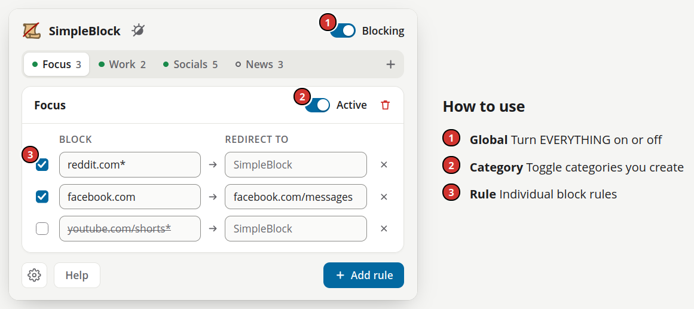
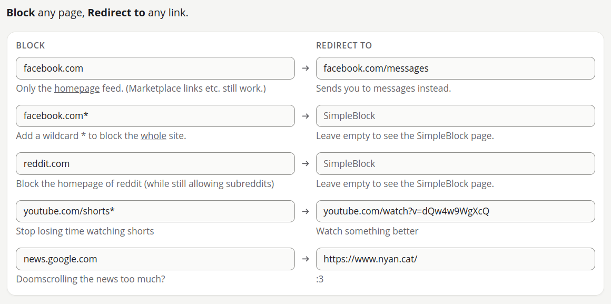

# SimpleBlock Extension

Stop endless scrolling and take control of your online habits with the SimpleBlock extension.
Block rules are intentionally simple and flexible so you're in control. Quickly enable/disable your rules so <em>you</em> can decide when it's time to focus.



## Features

- **Simple Unlimited Rules:** Create rules to block or redirect specific websites or pages
- **Flexibility:** Block a single page, or block a whole site
- **Categories:** Group rules into categories like "Work" or "Focus", and turn each on or off
- **Focus Mode:** Enable and disable rules on-demand for ultimate control over your browsing experience

## Installation

Install the extension from [Mozilla Add-ons](https://addons.mozilla.org/en-US/firefox/addon/simpleblock/)

##### Manual Installation / Development

Download and unzip the project, then type `about:debugging` in your address bar in Firefox. 
Under "This Firefox", find "Load Temporary Add-on" and load the `manifest.json` file.

To package the extension for addons.mozilla.org, run this from the project folder.

Deletes any old `SimpleBlock.zip`, then zips only the files the extension needs:

```sh
rm -f SimpleBlock.zip && zip -r -X SimpleBlock.zip manifest.json background popup pages shared options content icons/simpleblock-48.png -x '*.DS_Store'
```

## Usage

Click on the SimpleBlock icon (recommended you pin to your toolbar for easy access).




## Contributing

Contributions are welcome! If you find a bug or have a feature request, please [open an issue](https://github.com/Seltonu/SimpleBlock/issues).

*Note that SimpleBlock is designed to be intentionally simple, if you need complex rules please check out an extension like LeechBlock NG.*

## License

This project is licensed under the [MIT License](LICENSE).


